<p align="center">
  <a href="README.md">English</a> · <b>Русский</b>
</p>

<p align="center">
  
</p>

<h1 align="center">Wi-Fi Beacon Scanner</h1>

<p align="center">
  Wi-Fi сканер и диагностика для Windows 10/11: что вещают точки доступа, где слабое покрытие
  и почему ноутбук роумится или теряет связь.
</p>

<p align="center">
  <a href="https://github.com/salilov95/Wi-Fi-Beacon-Scanner/releases/latest"></a>
  <a href="https://github.com/salilov95/Wi-Fi-Beacon-Scanner/releases/latest"></a>
  <a href="https://github.com/salilov95/Wi-Fi-Beacon-Scanner/actions/workflows/ci.yml"></a>
  
  
  <a href="LICENSE"></a>
</p>

<p align="center">
  <a href="#возможности">Возможности</a> ·
  <a href="#откуда-берутся-данные">Откуда данные</a> ·
  <a href="#установка">Установка</a> ·
  <a href="#документация">Документация</a>
</p>

<p align="center">
  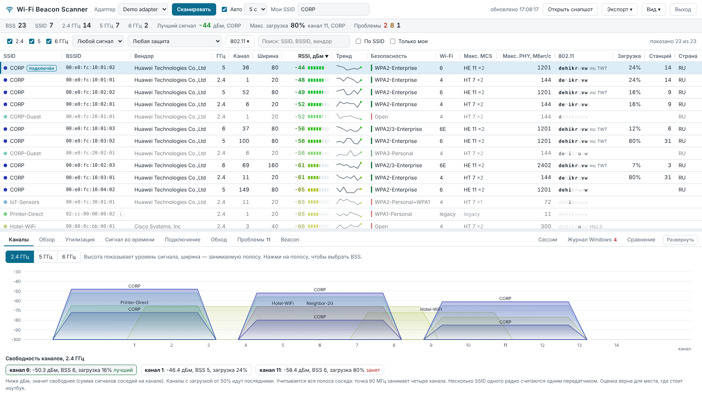
</p>

## Возможности

- **Таблица эфира** - все точки доступа 2.4, 5 и 6 ГГц: сигнал и тренд, канал и ширина, защита (WPA2/WPA3, PMF, AKM),
  поколение Wi-Fi, максимальный MCS и PHY-скорость, загрузка канала, клиенты, вендор. Автоскан раз в 5 секунд,
  столбцы можно скрывать и менять их ширину.
- **Дополнения 802.11** - d, e, h, i, k, r, u, v, w, а также mc (FTM), TWT, Multiple BSSID, Hotspot 2.0
  в колонке таблицы, в фильтре и в расшифровке beacon.
- **Каналы** - спектр каждого диапазона с зоной DFS и подсказка, какой канал свободнее.
- **Журнал подключения ноутбука** - роуминги, обрывы с причиной от Windows, пинг-понг, залипание на слабой точке.
- **Сессии подключения** - машина состояний клиента: ассоциация, 802.1X/EAP и 4-way, получение IP по DHCP
  с длительностью каждой стадии; результат 802.1X с причиной отказа и события Windows рядом с сессией.
- **Журнал Windows** - WLAN-AutoConfig за сутки, 3 дня или неделю: подключения, отказы и обрывы с причинами,
  загружается сам и обновляется раз в минуту.
- **Обход по плану этажа** - карта покрытия по точкам замеров (site survey).
- **Сигнал во времени** - графики и тепловая карта RSSI с автосканом.
- **Загрузка каналов** - QBSS Load из beacon, от зелёного к красному.
- **Проблемы** - 29 проверок безопасности, роуминга, радио и гигиены сети с подсказкой, что проверить.
- **Расшифровка beacon** - все Information Elements выбранной точки.
- **Отчёты** - PDF, Excel, HTML, CSV, JSON: по всем сетям, только по своим или как в таблице.
- **Русский и английский** - интерфейс, проблемы, расшифровка beacon и отчёты; язык берётся из Windows,
  переключается в «Вид» → «Язык».
- **Для раздачи на ноутбуки** - установщик с тихой установкой, семь тем, без внешних зависимостей.

### Дополнения 802.11

Какие дополнения объявляет каждая точка: d, e, h, i, k, r, u, v, w, а также FTM (802.11mc), FILS, mesh,
TWT, Multiple BSSID и Hotspot 2.0. В таблице - строка букв, в фильтре - «есть все отмеченные» или
«нет ни одного», с числом BSS у каждого пункта. Подробности по каждой точке (MDID, тип сети 802.11u,
Power Constraint, биты Extended Capabilities) - на вкладке «Beacon». Откуда что берётся - в
[документации](docs/ru/diagnostics.md#дополнения-80211-колонка-80211-и-фильтр).

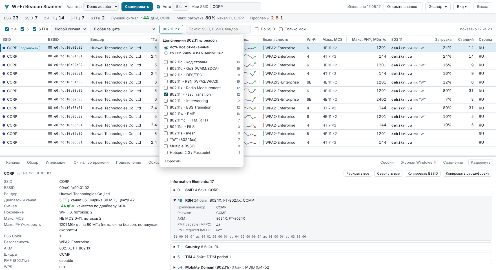

### Журнал подключения ноутбука

Программа следит за собственным подключением раз в секунду: на какой точке ноутбук, с каким сигналом
и скоростью. Видно каждый роуминг (откуда, куда, RSSI до и после, сколько продержался), обрывы с причиной
от Windows, пинг-понг между двумя точками и залипание, когда ноутбук держится за слабую точку при наличии
сильной. MCS текущего подключения оценивается по скорости приёма и передачи.

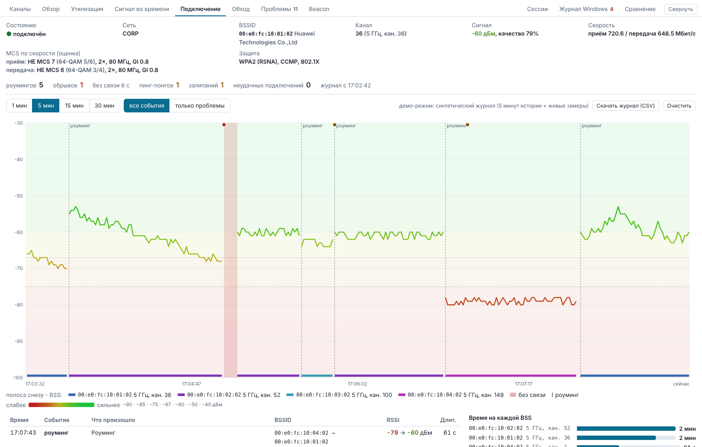

### Сессии подключения

Каждое подключение и каждый роуминг ноутбука разложены по стадиям по уведомлениям Windows: ассоциация,
аутентификация (обмен 802.1X/EAP и 4-way handshake), получение IPv4 по DHCP. Видно, сколько длилась каждая
стадия, чем закончилась аутентификация 802.1X (успех или отказ с причиной и кодом ошибки EAP, тип EAP,
учётка компьютера или пользователя), когда пришла аренда DHCP и от какого сервера. Быстрый FT-роуминг
(десятки мс) сразу отличается от роуминга с полной 802.1X-аутентификацией (сотни мс). В подробностях
сессии - события журнала Windows вокруг неё. Прав администратора не нужно.

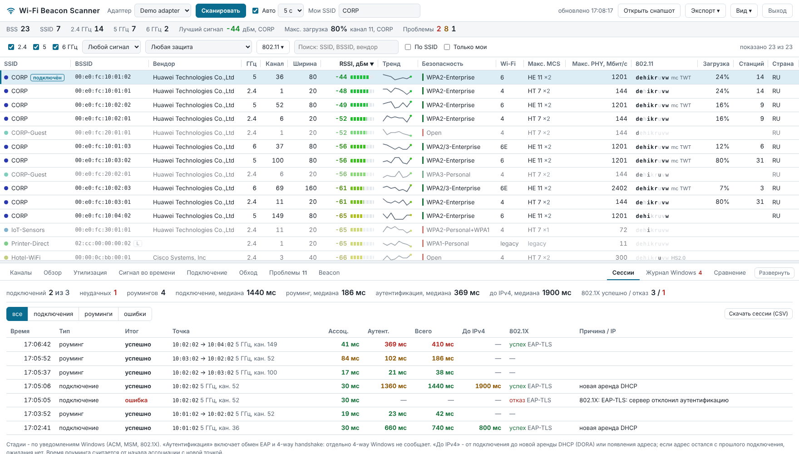

### Журнал Windows

События `Microsoft-Windows-WLAN-AutoConfig/Operational` с текстом из самой Windows: начало и итог
подключения, ассоциация, проверка безопасности и 4-way, 802.1X, отключения с причиной. Загружается
за сутки сразу при запуске и обновляется раз в минуту; фильтры по стадии и уровню, сводка частых
причин, все поля события по нажатию, выгрузка в CSV.

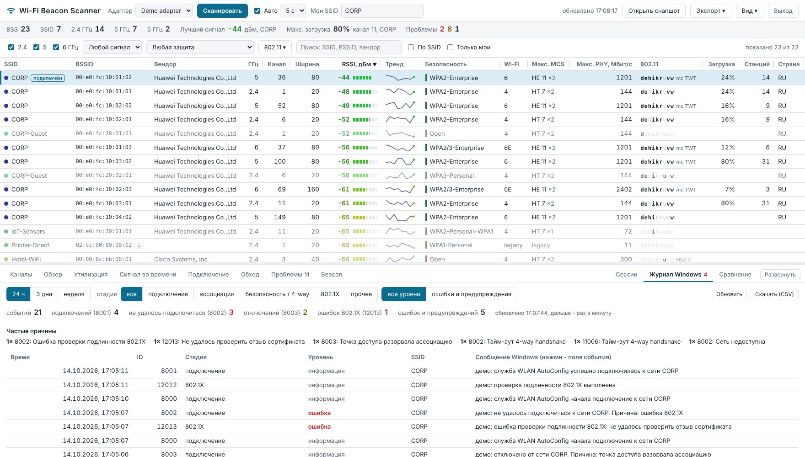

### Обход по плану этажа

Загрузите план этажа, ходите с ноутбуком и отмечайте, где стоите. В каждой точке программа делает скан
и строит карту покрытия: сигнал выбранной сети, сигнал подключения ноутбука или сколько точек доступа
слышно для роуминга. Вдали от замеров карта ничего не дорисовывает. Проект сохраняется в файл, карта - в PNG.

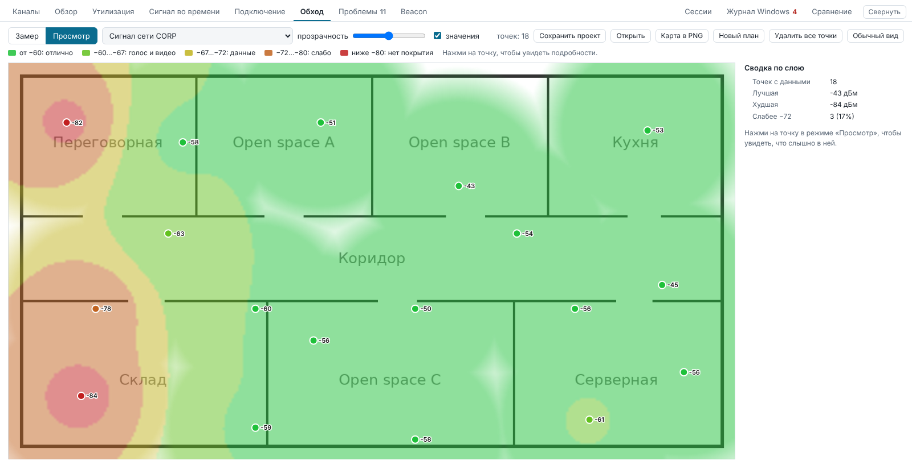

### Сигнал во времени

RSSI всех точек выбранной сети по сканам: линии окрашены по уровню, фон показывает зоны качества.
Есть тепловая карта «точка × скан», где сразу видно, какая точка пропадает.

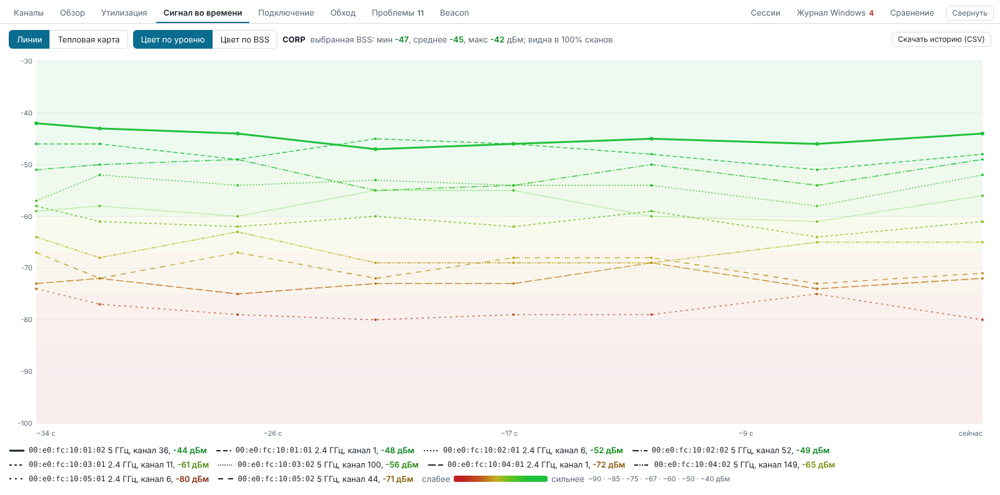

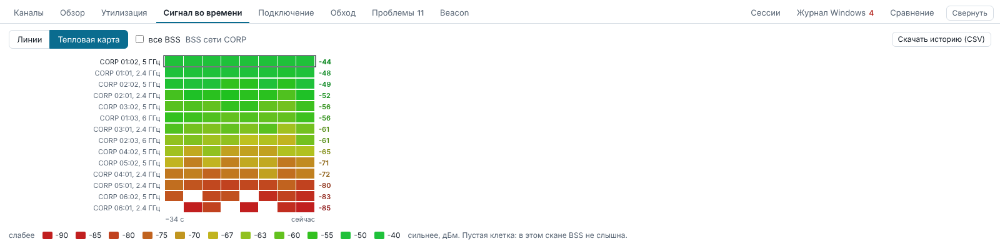

### Загрузка каналов

Сколько эфира занято на каждом канале по данным самих точек доступа (QBSS Load), число клиентов
и история по сканам. Каналы, где точки не сообщают загрузку, перечислены отдельно.

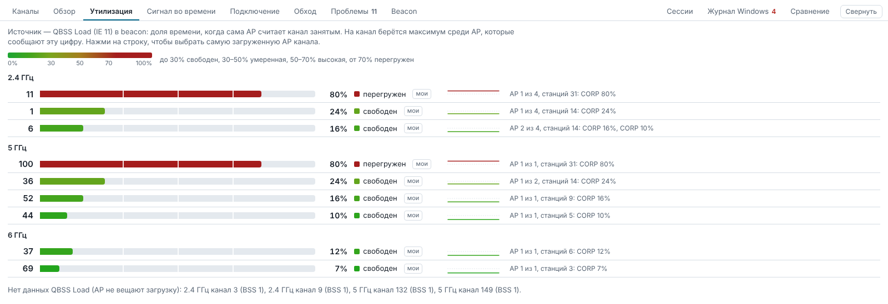

### Проблемы

Открытые и WEP-сети, TKIP, отсутствие PMF, 802.11k/r/v включены не на всех точках, разная защита
у одного SSID, перекрытие каналов в 2.4 ГГц, перегруженные каналы, слабый сигнал. Нажатие на проблему
подсвечивает затронутые точки в таблице. Полный список - в [документации](docs/ru/diagnostics.md).

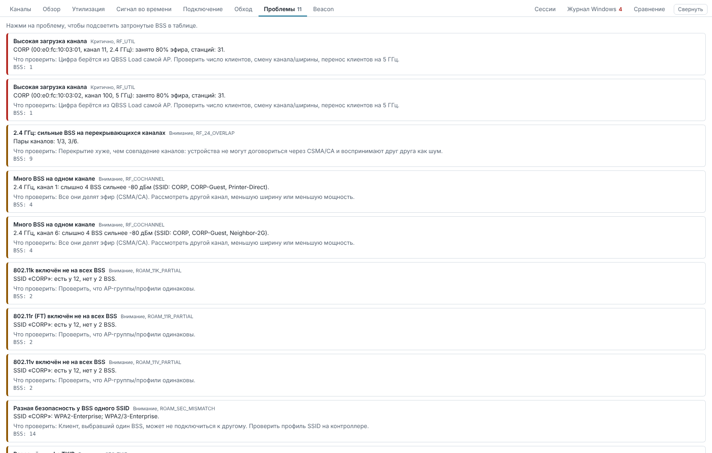

### Расшифровка beacon

Все Information Elements выбранной точки с расшифровкой и hex: RSN, HT/VHT/HE Capabilities и Operation,
наборы MCS, BSS Color, параметры 6 ГГц, vendor IE.

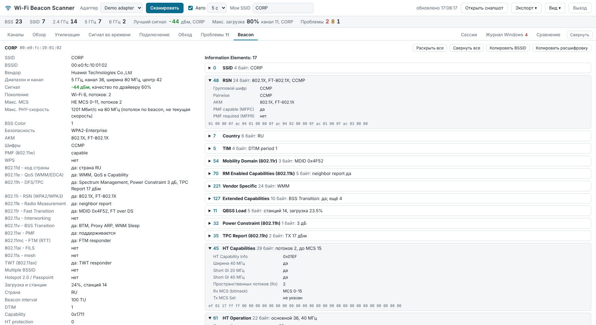

### Обзор эфира

Число точек по каналам, распределение по уровню сигнала, защите, поколениям Wi-Fi, ширине канала и вендорам.

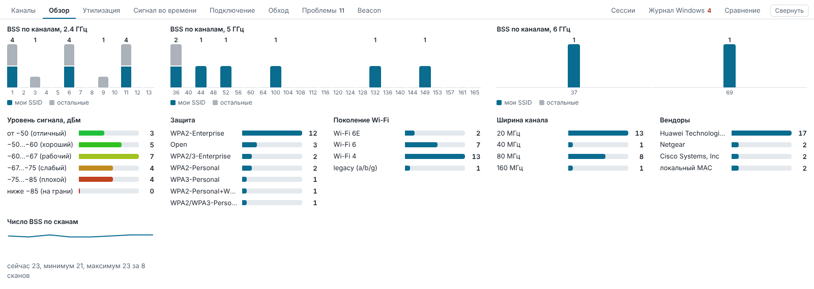

### Отчёты и темы

Отчёт в PDF и Excel (с цветовыми шкалами сигнала и загрузки), HTML, CSV, история замеров, журнал
подключения, снапшот JSON. Семь тем оформления, включая тёмную.

<table>
  <tr>
    <td width="50%" valign="top">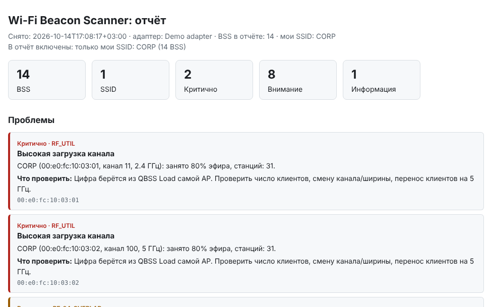</td>
    <td width="50%" valign="top">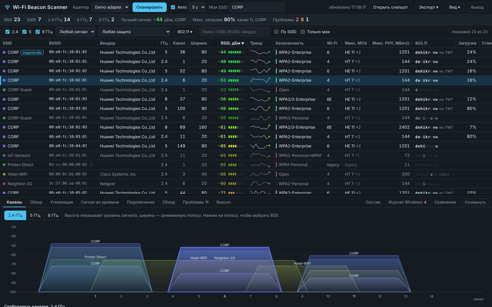</td>
  </tr>
</table>

## Откуда берутся данные

Только из Windows, без прав администратора и без доступа к контроллеру:

| Источник | Что даёт |
|---|---|
| `WlanScan` + `WlanGetNetworkBssList` (Native Wifi) | beacon / probe response из кэша службы WLAN AutoConfig: сырые IE, RSSI, частота, Capability |
| `WlanQueryInterface` раз в секунду | своё подключение: BSSID, RSSI, скорости приёма и передачи, канал |
| `WlanRegisterNotification` (ACM, MSM, ONEX) | стадии подключения и роуминга, причины отказов, результат 802.1X и ошибка EAP |
| `GetAdaptersInfo` | IPv4, DHCP-сервер, время получения аренды |
| журнал `Microsoft-Windows-WLAN-AutoConfig/Operational` | история подключений, отказов и отключений с текстом Windows |
| `manuf` из Wireshark | вендор по OUI |

Это не monitor mode: ретрансмиты, EAPOL и кадры роуминга так не увидеть. Интерфейс - локальная страница
на `127.0.0.1` в отдельном окне Edge; в интернет программа ходит только по кнопке «Проверить обновления».

## Установка

Скачайте со страницы [Releases](https://github.com/salilov95/Wi-Fi-Beacon-Scanner/releases/latest):

| Файл | Для чего |
|---|---|
| `WiFiBeaconScanner-Setup-<версия>.exe` | установщик: Program Files, ярлык в «Пуске», штатное удаление |
| `WiFiBeaconScanner.exe` | переносная версия одним файлом, без установки |

Тихая установка (SCCM, Intune, GPO, PDQ):

```
WiFiBeaconScanner-Setup-1.0.1.exe /VERYSILENT /SUPPRESSMSGBOXES /NORESTART /SP-
```

Файлы не подписаны сертификатом, поэтому при ручном запуске SmartScreen попросит подтверждение
(«Подробнее» → «Выполнить в любом случае»). Подробности - в [установке и раздаче](docs/ru/deployment.md).

Из исходников (Python 3.8+, зависимостей нет):

```
python -m wifi_beacon_scanner gui            # сканировать
python -m wifi_beacon_scanner gui --demo     # посмотреть на демо-данных
```

## Документация

- [Установка и раздача на ноутбуки](docs/ru/deployment.md) - тихая установка, где хранятся данные, ограничения
- [Диагностика](docs/ru/diagnostics.md) - все проверки, дополнения 802.11, шкала сигнала, загрузка канала, MCS и PHY-скорость
- [Журнал подключения и сессии](docs/ru/connection-journal.md) - роуминги, обрывы, стадии подключения, 802.1X, DHCP
- [Разработка, сборка и выпуск](docs/ru/development.md) - запуск из исходников, CLI, тесты, сборка exe, релизы
- [История изменений](CHANGELOG.ru.md)
- [Как вносить изменения](CONTRIBUTING.ru.md) · [Безопасность](SECURITY.md) · [Правила поведения](CODE_OF_CONDUCT.md)

## Лицензия

[MIT](LICENSE)
